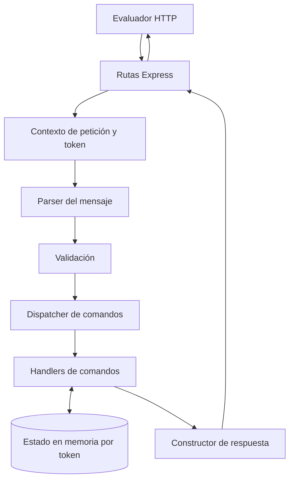
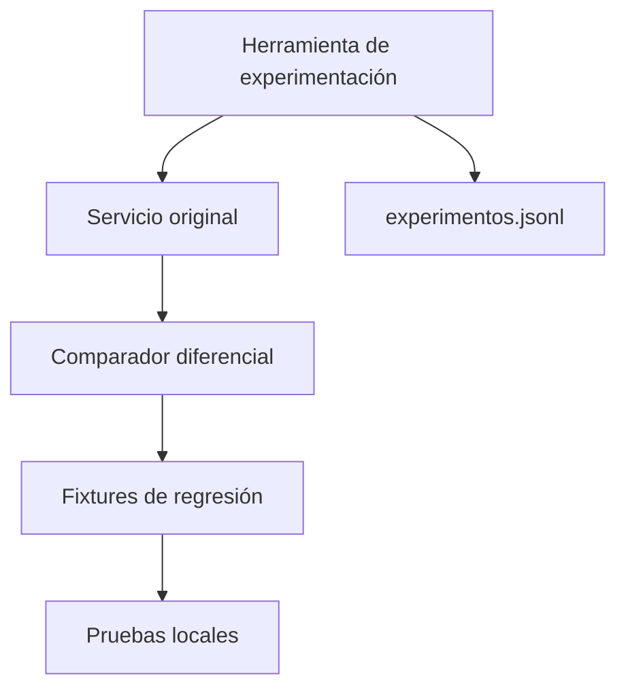

# Arquitectura — Reto 2: La caja negra

Este archivo separa los diagramas del documento de diseño para facilitar su previsualización. Se usan diagramas Mermaid sencillos, con direcciones y subgrafos independientes para evitar cruces innecesarios.

## Servicio desplegado

El estado se separa por token. `POST /__reset` restablece el estado del token correspondiente. El adaptador HTTP debe preservar el status y el cuerpo que produzca el núcleo.

## Laboratorio de desarrollo (no desplegado)

Este laboratorio es independiente del servicio desplegado. La herramienta de experimentación puede consultar el original; el runtime del reemplazo no debe importarlo, invocarlo ni depender de su disponibilidad.
