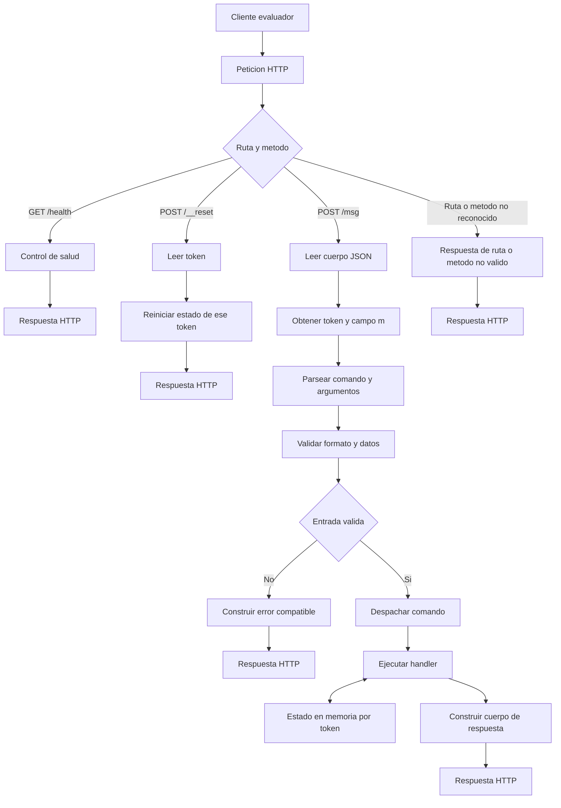
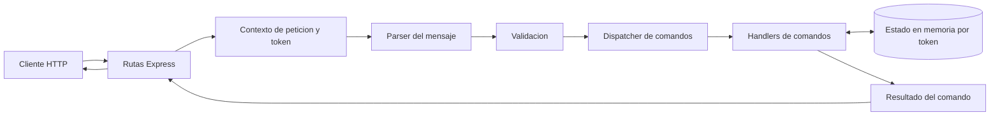
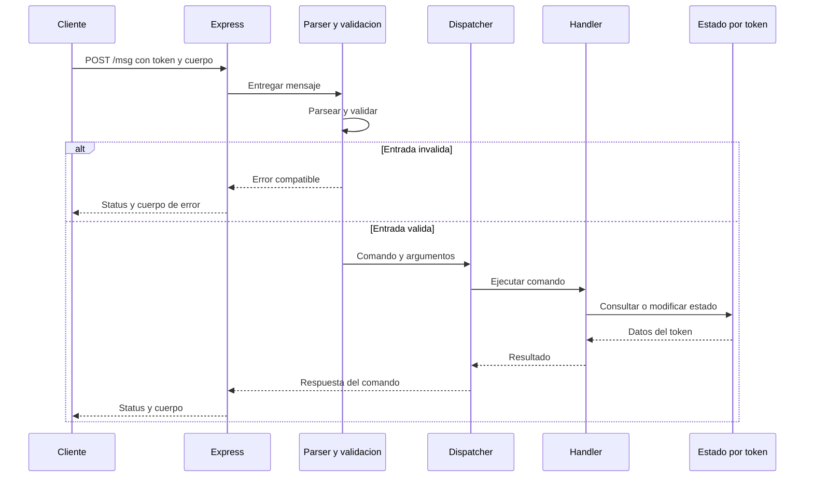
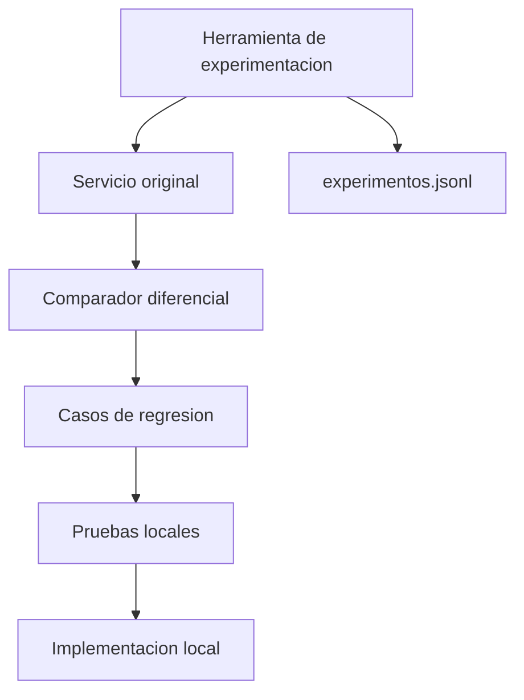

# Arquitectura — Reto 2: La caja negra

Este documento muestra el recorrido de una petición desde que entra por HTTP hasta que se devuelve la respuesta, además de los componentes internos y el laboratorio de investigación. Los diagramas usan sintaxis Mermaid básica para facilitar la previsualización.

## 1. Flujo completo de una petición

### Lectura del flujo

1. El cliente envía una petición HTTP al servicio.
2. Express identifica la ruta y el método. `/health`, `/__reset` y `/msg` siguen caminos distintos.
3. En `/msg`, el servicio obtiene el token y el campo `m`, analiza el mensaje y valida su estructura.
4. Si la entrada es válida, el dispatcher dirige el comando al handler correspondiente.
5. El handler consulta o modifica el estado asociado a ese token y produce el resultado.
6. El adaptador HTTP devuelve el status y el cuerpo. Los errores también deben reproducir el comportamiento observable del servicio original.

El orden exacto de validaciones y los formatos de error no se deben dar por confirmados hasta medirlos contra el original. El diagrama representa la arquitectura propuesta, no afirma que todas las reglas ya estén implementadas.

## 2. Componentes del servicio desplegado

| Componente | Responsabilidad |
|---|---|
| Rutas Express | Recibir HTTP, seleccionar la ruta y devolver status y cuerpo. |
| Contexto de petición y token | Identificar el token que delimita el estado de la sesión. |
| Parser | Separar el mensaje en comando y argumentos sin inventar reglas de formato. |
| Validación | Comprobar condiciones observadas y mantener el orden de validación compatible. |
| Dispatcher | Enviar el comando reconocido a su handler. |
| Handlers | Ejecutar la operación y construir el resultado del comando. |
| Estado en memoria | Guardar los datos necesarios entre peticiones para cada token. |

`POST /__reset` debe limpiar solo el estado del token correspondiente. El estado en memoria no persiste tras reiniciar el proceso; por ello, el despliegue debe respetar la limitación de una instancia si no existe un mecanismo compartido.

## 3. Secuencia interna de `POST /msg`

## 4. Laboratorio de desarrollo — fuera del despliegue

El laboratorio se utiliza durante la investigación para formular hipótesis, enviar solicitudes controladas, registrar resultados y crear pruebas de regresión. No forma parte del proceso desplegado.

**Restricción importante:** el servicio desplegado no debe llamar, importar ni depender del servicio original ni de otra implementación de reemplazo. La comunicación con el original se limita a las herramientas de experimentación ejecutadas por separado.

## 5. Límites y aspectos por confirmar

- El diagrama describe el flujo previsto; no demuestra que el comportamiento ya esté implementado.
- Los códigos HTTP, mensajes de error, orden de validación y reglas de cada comando deben confirmarse con experimentos.
- Los errores automáticos de Express y del parseo JSON deben revisarse para evitar respuestas distintas de las del original.
- El estado en memoria se pierde al reiniciar el proceso y no se comparte entre instancias.
